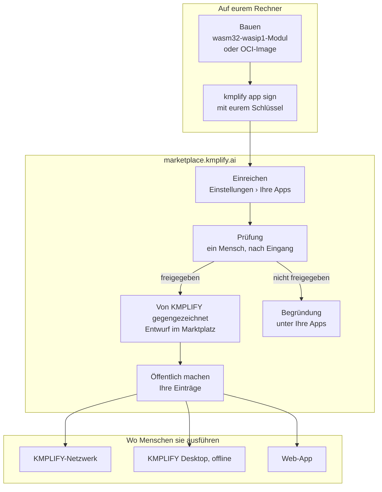
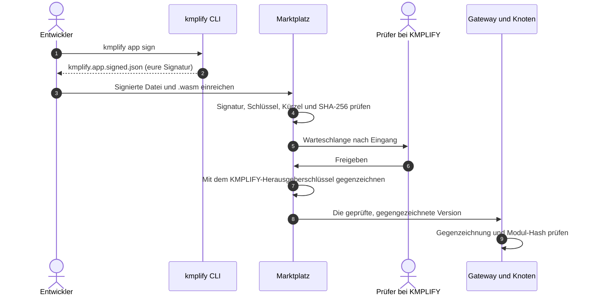
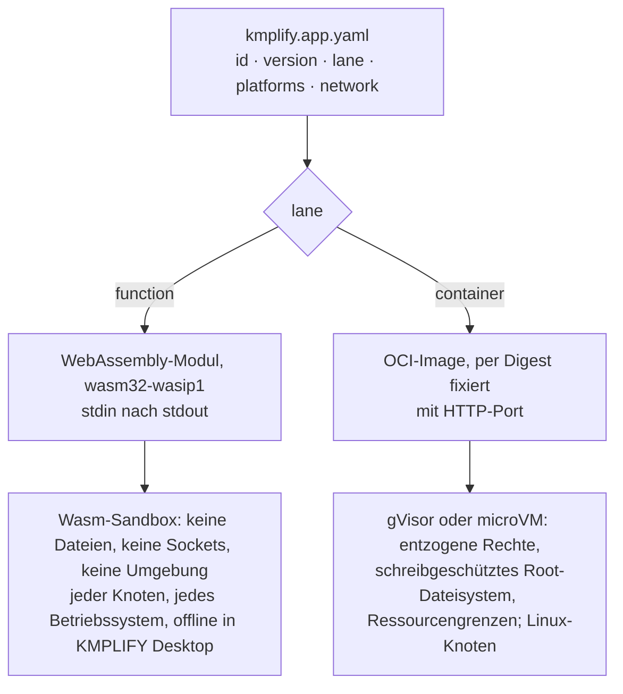

<div align="center">

<a href="https://kmplify.io/de/plattform/serverless-apps">
  
</a>

# kmplify-dev-sdk

[English](README.md) · **Deutsch**

### Serverless Apps für die KMPLIFY Compute Fabric bauen, signieren und im Marktplatz veröffentlichen.

Eine Serverless App ist ein kleines Programm in einer Sandbox. Sie läuft auf Servern, die KMPLIFY betreibt,<br>
auf Rechnern, die Menschen dem Netzwerk leihen, und offline in KMPLIFY Desktop.<br>
Ihr baut und signiert sie hier, ein Mensch bei KMPLIFY prüft sie, danach kann sie jede und jeder hinzufügen.

[](https://github.com/kmplify/kmplify-dev-sdk/actions/workflows/ci.yml)
[](LICENSE)
[](cli/Cargo.toml)
[](https://rustup.rs)
[](docs/MANIFEST.md)
[](#die-zwei-lanes)

[](https://kmplify.io/de/docs/serverless-apps)
&nbsp;
[](https://marketplace.kmplify.ai/settings/developer-apps)

[Anleitung](https://kmplify.io/de/docs/serverless-apps) ·
[Was Serverless Apps sind](https://kmplify.io/de/plattform/serverless-apps) ·
[Schnellstart](#schnellstart) ·
[So funktioniert es](#so-funktioniert-es) ·
[Manifest](docs/MANIFEST.md) ·
[Signatur](docs/SIGNING.md) ·
[Roadmap](docs/ROADMAP.md) ·
[Sicherheit](SECURITY.md)

</div>

---

## Warum darauf bauen

| | |
|---|---|
| **Läuft dort, wo eure Nutzer sind** | Eine App erreicht die Web-App, KMPLIFY Desktop und Smartphones, so weit es `platforms` im Manifest erlaubt. |
| **Sicher auf fremden Rechnern** | Jede App ist ein signiertes Paket in einer Sandbox, nie nur ein Image-Name: Eine WebAssembly-Funktion hat keine Dateien, keine Sockets und keine Umgebung; ein Container läuft mindestens unter gVisor. |
| **Von einem Menschen geprüft** | Jede Version wartet in einer Warteschlange nach Eingang und wird von einem Menschen bei KMPLIFY geprüft, bevor sie irgendwo läuft. |
| **Euer Schlüssel, euer Name** | Ihr signiert mit einem Schlüssel, der euren Rechner nie verlässt. KMPLIFY gegenzeichnet erst nach der Prüfung, so kann niemand eine veränderte Kopie unter eurem Namen ausführen. |
| **Kostenlos oder kostenpflichtig** | Veröffentlicht mit den Preismodellen und der Umsatzaufteilung des Marktplatzes. |
| **Offenes SDK** | Apache-2.0. Die CLI zeigt Fehler früh; Gateway und jeder Knoten prüfen dieselben Regeln noch einmal, deshalb kostet das offene SDK keine Sicherheit. |

## Schnellstart

Ihr braucht [Rust](https://rustup.rs) und für eine Funktion das Ziel
`wasm32-wasip1` (`rustup target add wasm32-wasip1`).

```bash
git clone https://github.com/kmplify/kmplify-dev-sdk
cd kmplify-dev-sdk/cli && cargo install --path .   # installiert den Befehl `kmplify`
kmplify --version

kmplify keys create                     # euer Signaturschlüssel, bleibt auf diesem Rechner
kmplify keys show                       # der öffentliche Teil: im Marktplatz eintragen
kmplify app init my-app --id acme/my-app --lane function
# Modul schreiben und bauen, dann:
kmplify app validate my-app
kmplify app sign my-app                 # schreibt my-app/kmplify.app.signed.json
kmplify app verify my-app/kmplify.app.signed.json --pubkey "$(kmplify keys show)"
```

`examples/hello-function` lässt sich so signieren und prüfen, wie es ist. Die
[Anleitung](https://kmplify.io/de/docs/serverless-apps) baut ein vollständiges
Beispiel, `acme/word-count`, Schritt für Schritt mit Screenshots.

## So funktioniert es



1. **Einmal registrieren.** Meldet euch auf [marketplace.kmplify.ai](https://marketplace.kmplify.ai)
   an, öffnet **Einstellungen > Ihre Apps** und tragt euer Kürzel ein (der Teil
   vor dem `/` in der App-ID, dauerhaft festgelegt) sowie die Ausgabe von
   `kmplify keys show`. Mit **Schlüssel ersetzen** registriert ihr später einen neuen.
2. **Einreichen.** Wählt `kmplify.app.signed.json` und bei einer Funktion das
   `.wasm`-Modul, dann **Zur Prüfung einreichen**. Der Marktplatz prüft Signatur,
   Schlüssel, Kürzel und den SHA-256 des Moduls noch einmal. Pro Konto können
   bis zu 5 Apps warten.
3. **Prüfung.** Ein Mensch bei KMPLIFY prüft jede Einreichung in der Reihenfolge
   des Eingangs. **Ihre Apps** zeigt die Position in der Warteschlange, die
   Entscheidung und bei einer Ablehnung die Begründung.
4. **Veröffentlichen.** Eine freigegebene App bekommt einen privaten Entwurf im
   Marktplatz. Ergänzt Beschreibung und Bild, dann **Öffentlich machen** unter
   **Ihre Einträge**. Danach fügen Menschen sie im Marktplatz hinzu und führen sie aus.

Eine neue Version ist eine neue Einreichung mit höherer `version`, signiert mit
eurem registrierten Schlüssel, und durchläuft dieselbe Prüfung. Die ganze
Anleitung, mit Antworten beim Ausführen und dem Stoppen einer App, steht in der
[Anleitung](https://kmplify.io/de/docs/serverless-apps).

### Die Vertrauenskette



Knoten führen nur Apps mit der Gegenzeichnung des KMPLIFY-Herausgebers aus.
Dieses SDK kann diese Signatur nicht erzeugen, und eine App, die sich als
schädlich herausstellt, wird überall auf einmal abgeschaltet.

## Die zwei Lanes



| Lane | Was es ist | Läuft auf | Sandbox |
|---|---|---|---|
| `function` | ein WebAssembly-Modul (`wasm32-wasip1`), stdin nach stdout | jedem Knoten, jedem Betriebssystem | Wasm-Laufzeit: keine Dateien, keine Sockets, keine Umgebung |
| `container` | ein OCI-Image, per Digest fixiert, mit HTTP-Port | Linux-Knoten mit gVisor- oder microVM-Laufzeit | mindestens gVisor, zusätzlich entzogene Rechte, schreibgeschütztes Root-Dateisystem und Ressourcengrenzen |

## Stand

| Teil | Stand |
|---|---|
| Manifest `kmplify.app/v1` und sein JSON Schema | verfügbar |
| `kmplify`-CLI: `app init`, `app validate`, `keys create/list/show`, `app sign`, `app verify` | verfügbar |
| Signierte App zur Prüfung einreichen | verfügbar im Marktplatz: Einstellungen > [Ihre Apps](https://marketplace.kmplify.ai/settings/developer-apps) |
| Funktions-Apps im KMPLIFY-Netzwerk und offline in KMPLIFY Desktop | verfügbar |
| Container-Apps im KMPLIFY-Netzwerk | geplant: Eine Container-App kann geprüft und gelistet werden, ein Aufruf im Netzwerk antwortet, dass Container dort noch nicht laufen |
| `kmplify app test` (lokal in derselben Sandbox wie ein Knoten ausführen) | geplant; bis dahin funktioniert jede WASI-Laufzeit wie `wasmtime` |
| `kmplify login`, `kmplify app publish` (Einreichen von der Kommandozeile) | geplant |
| Laufzeit-Bibliotheken (KV, Bucket, Queue, Secrets) für Python, JS, Rust | geplant |

Siehe [docs/ROADMAP.md](docs/ROADMAP.md).

## Aufbau

```
cli/        Befehl und Bibliothek `kmplify` (Rust)
schema/     kmplify.app.v1.schema.json, für Editoren und die Serverseite
examples/   hello-function (signiert so, wie es ist), hello-container
docs/       MANIFEST.md, SIGNING.md, ROADMAP.md
```

## Entwicklung

```bash
cd cli
cargo test          # Unit-Tests, Schema-Abgleich, End-to-End-Tests der CLI
cargo clippy --all-targets -- -D warnings
cargo fmt --check
```

## Mehr erfahren

| | |
|---|---|
| Schritt-für-Schritt-Anleitung mit Screenshots | [kmplify.io/de/docs/serverless-apps](https://kmplify.io/de/docs/serverless-apps) · [English](https://kmplify.io/docs/serverless-apps) |
| Was Serverless Apps sind und wo sie laufen | [kmplify.io/de/plattform/serverless-apps](https://kmplify.io/de/plattform/serverless-apps) · [English](https://kmplify.io/platform/serverless-apps) |
| Die KMPLIFY Compute Fabric | [kmplify.io/de/plattform/compute-fabric](https://kmplify.io/de/plattform/compute-fabric) |
| Apps einreichen und verfolgen | [marketplace.kmplify.ai/settings/developer-apps](https://marketplace.kmplify.ai/settings/developer-apps) |
| Manifest-Referenz und Signaturformat | [docs/MANIFEST.md](docs/MANIFEST.md) · [docs/SIGNING.md](docs/SIGNING.md) (Englisch) |

## Sicherheit

Das SDK ist bewusst offen: In [SECURITY.md](SECURITY.md) steht, warum das sicher
ist und wie ihr eine Schwachstelle vertraulich meldet.

## Lizenz

Apache License 2.0, siehe [LICENSE](LICENSE) und [NOTICE](NOTICE). Apps, die ihr
mit dem SDK baut, gehören euch und dürfen jede Lizenz tragen, die ihr wählt.

<div align="center">
<br>
<sub><a href="https://kmplify.io/de">kmplify.io</a> · <a href="https://marketplace.kmplify.ai">marketplace.kmplify.ai</a> · <a href="https://kmplify.ai/de">kmplify.ai</a></sub>
</div>
