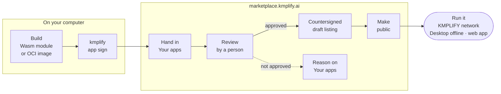
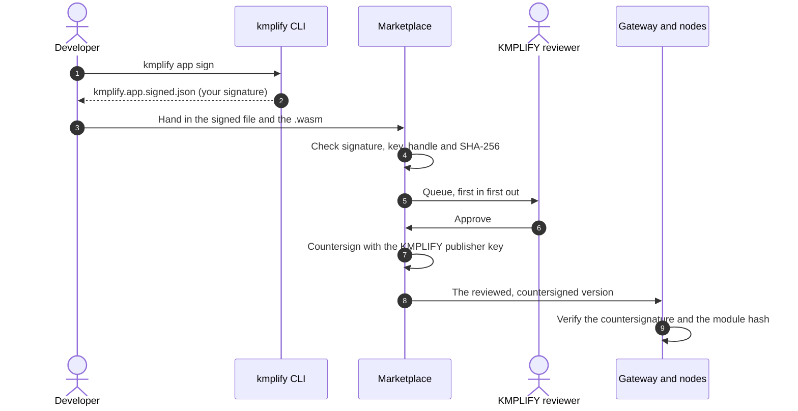
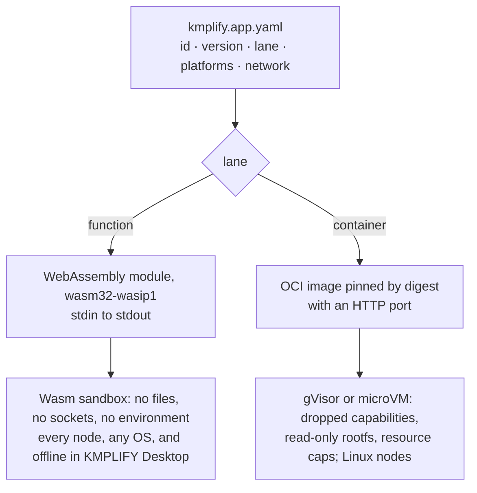

<div align="center">

<a href="https://kmplify.io/platform/serverless-apps">
  
</a>

# kmplify-dev-sdk

**English** · [Deutsch](README.de.md)

### Build serverless apps for the KMPLIFY Compute Fabric, sign them, and publish them on the marketplace.

A serverless app is a small, sandboxed program that runs on servers KMPLIFY operates,<br>
on computers people lend to the network, and offline in KMPLIFY Desktop.<br>
You build and sign it here; a person at KMPLIFY reviews it; then anyone can add it.

[](https://github.com/kmplify/kmplify-dev-sdk/actions/workflows/ci.yml)
[](LICENSE)
[](cli/Cargo.toml)
[](https://rustup.rs)
[](docs/MANIFEST.md)
[](#the-two-lanes)

[](https://kmplify.io/docs/serverless-apps)
&nbsp;
[](https://marketplace.kmplify.ai/settings/developer-apps)

[Guide](https://kmplify.io/docs/serverless-apps) ·
[What serverless apps are](https://kmplify.io/platform/serverless-apps) ·
[Quick start](#quick-start) ·
[How it works](#how-it-works) ·
[Manifest](docs/MANIFEST.md) ·
[Signing](docs/SIGNING.md) ·
[Roadmap](docs/ROADMAP.md) ·
[Security](SECURITY.md)

</div>

---

## Why build on it

| | |
|---|---|
| **Runs where your users are** | One app reaches the web app, KMPLIFY Desktop and phones, wherever its manifest's `platforms` allow. |
| **Safe on other people's machines** | Every app is a signed, sandboxed package, never just an image name: a WebAssembly function has no files, sockets or environment; a container runs below gVisor at least. |
| **Reviewed by a person** | Every version waits in one first-in, first-out queue and is reviewed by a person at KMPLIFY before it can run anywhere. |
| **Your key, your name** | You sign with a key that never leaves your computer. KMPLIFY countersigns only after the review, so nobody can run a changed copy under your name. |
| **Free or paid** | Publish under the marketplace's own pricing models and revenue split. |
| **Open SDK** | Apache-2.0. The CLI shows mistakes early; the gateway and every node check the same rules again, so the SDK being open costs nothing in safety. |

## Quick start

You need [Rust](https://rustup.rs) and, for a function, the `wasm32-wasip1`
target (`rustup target add wasm32-wasip1`).

```bash
git clone https://github.com/kmplify/kmplify-dev-sdk
cd kmplify-dev-sdk/cli && cargo install --path .   # installs the `kmplify` binary
kmplify --version

kmplify keys create                     # your signing key, stays on this machine
kmplify keys show                       # the public half: register it on the marketplace
kmplify app init my-app --id acme/my-app --lane function
# write and build your module, then:
kmplify app validate my-app
kmplify app sign my-app                 # writes my-app/kmplify.app.signed.json
kmplify app verify my-app/kmplify.app.signed.json --pubkey "$(kmplify keys show)"
```

`examples/hello-function` signs and verifies as it is. The
[guide](https://kmplify.io/docs/serverless-apps) builds a complete example,
`acme/word-count`, step by step with screenshots.

## How it works



1. **Register once.** Sign in on [marketplace.kmplify.ai](https://marketplace.kmplify.ai),
   open **Settings > Your apps**, and enter your handle (the part before the `/`
   in your app id, fixed for good) and the output of `kmplify keys show`.
   **Replace key** registers a new key later.
2. **Hand in.** Choose `kmplify.app.signed.json` and, for a function, the
   `.wasm` module, then **Hand in for review**. The marketplace checks the
   signature, your key, your handle and the module's SHA-256 again. Up to 5
   apps can wait per account.
3. **Review.** A person at KMPLIFY reviews every submission in the order it
   arrived. **Your apps** shows the queue position, the decision, and for a
   rejection the reviewer's reason.
4. **Publish.** An approved app gets a private draft listing. Add a
   description and picture, then **Make public** under **Your listings**.
   People add it on the marketplace and run it.

A new version is a new submission with a higher `version`, signed with your
registered key, and goes through the same review. The full walkthrough,
including run answers and how to stop an app, is in the
[guide](https://kmplify.io/docs/serverless-apps).

### The chain of trust



Nodes only run apps carrying the KMPLIFY publisher's countersignature. This SDK
cannot make that signature, and an app that turns out to be harmful is switched
off everywhere at once.

## The two lanes



| Lane | What it is | Runs on | Sandbox |
|---|---|---|---|
| `function` | a WebAssembly module (`wasm32-wasip1`), stdin to stdout | every node, any OS | Wasm runtime: no files, no sockets, no environment |
| `container` | an OCI image pinned by digest, with an HTTP port | Linux nodes with a gVisor or microVM runtime | gVisor at least, on top of dropped capabilities, read-only rootfs and resource caps |

## Status

| Piece | State |
|---|---|
| `kmplify.app/v1` manifest and its JSON Schema | available |
| `kmplify` CLI: `app init`, `app validate`, `keys create/list/show`, `app sign`, `app verify` | available |
| Hand in a signed app for review | available on the marketplace: Settings > [Your apps](https://marketplace.kmplify.ai/settings/developer-apps) |
| Function apps on the KMPLIFY network and offline in KMPLIFY Desktop | available |
| Container apps on the KMPLIFY network | planned: a container app can be reviewed and listed, a network run answers that containers cannot run there yet |
| `kmplify app test` (run locally in the same sandbox a node uses) | planned; any WASI runtime such as `wasmtime` works meanwhile |
| `kmplify login`, `kmplify app publish` (hand in from the command line) | planned |
| Runtime libraries (KV, bucket, queue, secrets) for Python, JS, Rust | planned |

See [docs/ROADMAP.md](docs/ROADMAP.md).

## Layout

```
cli/        the `kmplify` binary and library (Rust)
schema/     kmplify.app.v1.schema.json, for editors and the server side
examples/   hello-function (signs as is), hello-container
docs/       MANIFEST.md, SIGNING.md, ROADMAP.md
```

## Development

```bash
cd cli
cargo test          # unit tests, schema agreement, end-to-end CLI tests
cargo clippy --all-targets -- -D warnings
cargo fmt --check
```

## Learn more

| | |
|---|---|
| Step-by-step guide with screenshots | [kmplify.io/docs/serverless-apps](https://kmplify.io/docs/serverless-apps) · [Deutsch](https://kmplify.io/de/docs/serverless-apps) |
| What serverless apps are and where they run | [kmplify.io/platform/serverless-apps](https://kmplify.io/platform/serverless-apps) · [Deutsch](https://kmplify.io/de/plattform/serverless-apps) |
| The KMPLIFY Compute Fabric | [kmplify.io/platform/compute-fabric](https://kmplify.io/platform/compute-fabric) |
| Hand in and follow your apps | [marketplace.kmplify.ai/settings/developer-apps](https://marketplace.kmplify.ai/settings/developer-apps) |
| Manifest reference and signing format | [docs/MANIFEST.md](docs/MANIFEST.md) · [docs/SIGNING.md](docs/SIGNING.md) |

## Security

The SDK is open on purpose: see [SECURITY.md](SECURITY.md) for why that is safe
and for how to report a vulnerability privately.

## License

Apache License 2.0, see [LICENSE](LICENSE) and [NOTICE](NOTICE). Apps you build
with the SDK are yours and may carry any license you choose.

<div align="center">
<br>
<sub><a href="https://kmplify.io">kmplify.io</a> · <a href="https://marketplace.kmplify.ai">marketplace.kmplify.ai</a> · <a href="https://kmplify.ai">kmplify.ai</a></sub>
</div>
