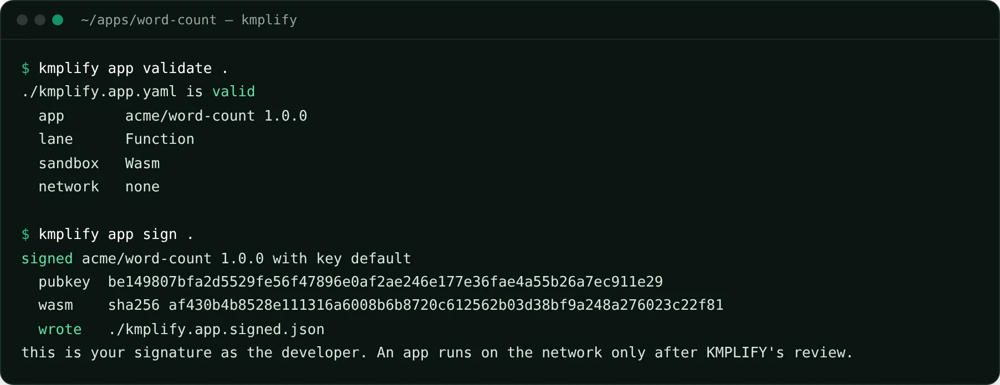
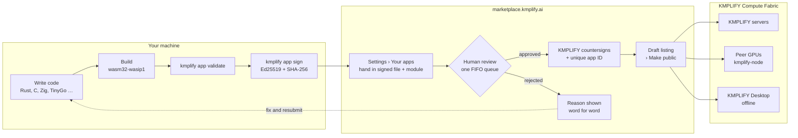
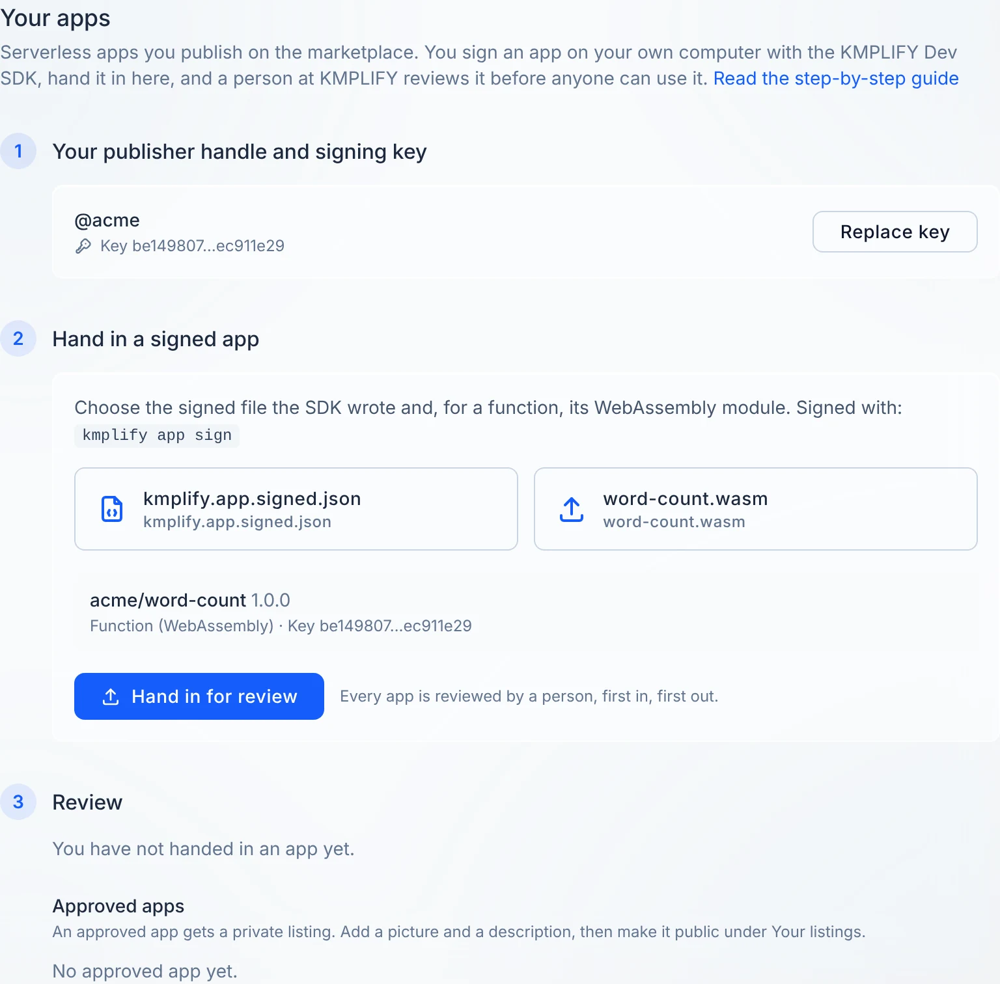
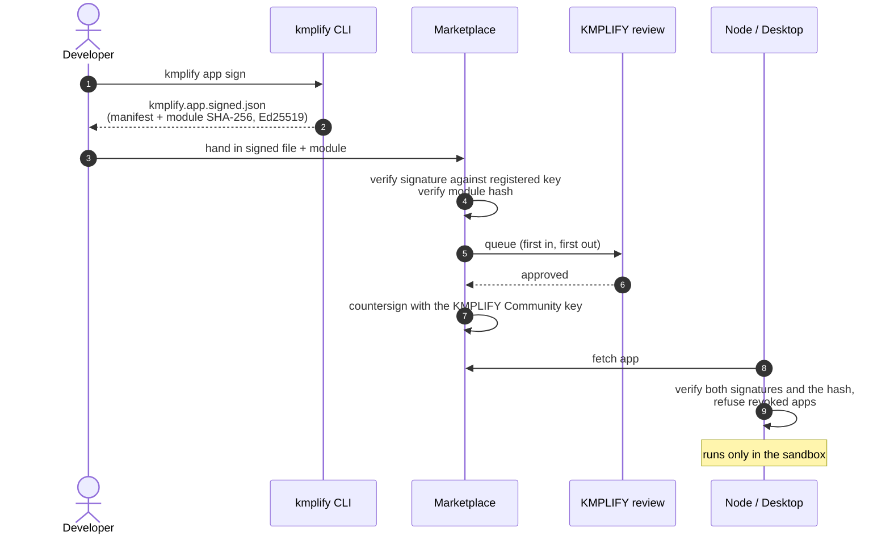

<div align="center">

<a href="https://kmplify.io">
  <picture>
    <source media="(prefers-color-scheme: dark)" srcset=".github/assets/kmplify-logo-dark.svg">
    
  </picture>
</a>

<h1>KMPLIFY Dev SDK</h1>

**Build, sign and publish serverless apps for the KMPLIFY Compute Fabric.**<br>
Write a small program, sign it with your own key, hand it in, and after a human review
it runs on KMPLIFY servers, on peer GPUs across the network and offline in KMPLIFY Desktop.

[](https://github.com/kmplify/kmplify-dev-sdk/actions/workflows/ci.yml)
[](LICENSE)


<br>

[](https://kmplify.io/docs/serverless-apps)
[](https://marketplace.kmplify.ai)

<h3>
  <a href="https://kmplify.io/docs/serverless-apps">Step-by-step guide</a>
  ·
  <a href="https://kmplify.io/platform/serverless-apps">What serverless apps are</a>
  ·
  <a href="https://kmplify.io/services/serverless-apps">Use case</a>
  ·
  <a href="https://marketplace.kmplify.ai/settings/developer-apps">Hand in your app</a>
</h3>

<sub>
  <a href="#quick-start">Quick start</a> ·
  <a href="#how-it-works">How it works</a> ·
  <a href="#from-signed-app-to-marketplace">Publish</a> ·
  <a href="#the-two-lanes">Lanes</a> ·
  <a href="#trust-model">Trust model</a> ·
  <a href="#status">Status</a> ·
  <a href="#development">Development</a> ·
  <a href="https://kmplify.io/de/docs/serverless-apps">Deutsch</a>
</sub>

</div>

---

## Why

A serverless app on KMPLIFY can run on someone else's computer: a peer GPU on the
network, or a colleague's KMPLIFY Desktop. So an app is never just an image name. It is
a **signed, sandboxed package**, its publisher is known, a person has reviewed it, and
every node checks all of that again before it runs a single byte.

The SDK gives you the tools for your side of that bargain:

| | |
|---|---|
| **`kmplify keys`** | Creates your Ed25519 signing key. The private half never leaves your machine. |
| **`kmplify app init`** | Writes a starter `kmplify.app.yaml` for a function or a container. |
| **`kmplify app validate`** | Checks the manifest with the same rules the network enforces, so mistakes show up early. |
| **`kmplify app sign`** | Hashes the module, signs manifest and hash, writes `kmplify.app.signed.json`. |
| **`kmplify app verify`** | Confirms a signed file against a public key, exactly as a node will. |

## Quick start

You need [Rust](https://rustup.rs). For a function, also the WebAssembly target:
`rustup target add wasm32-wasip1`.

```bash
git clone https://github.com/kmplify/kmplify-dev-sdk
cd kmplify-dev-sdk/cli && cargo install --path .   # installs the `kmplify` binary
kmplify --version

kmplify keys create                     # your signing key, stays on this machine
kmplify keys show                       # the public half: register it on the marketplace
kmplify app init my-app --id acme/my-app --lane function
# write and build your module, then:
kmplify app validate my-app
kmplify app sign my-app                 # writes my-app/kmplify.app.signed.json
kmplify app verify my-app/kmplify.app.signed.json --pubkey "$(kmplify keys show)"
```

`examples/hello-function` signs and verifies as it is.

<p align="center">
  <br>
  <sub>Validating and signing a function. The module's SHA-256 becomes part of what you sign.</sub>
</p>

> [!TIP]
> The [step-by-step guide](https://kmplify.io/docs/serverless-apps) builds a complete
> example (a word counter in Rust) from an empty folder to a public marketplace listing,
> with screenshots of every step.

## How it works



## From signed app to marketplace

1. **Register once.** Sign in on [marketplace.kmplify.ai](https://marketplace.kmplify.ai),
   open **Settings › Your apps**, and enter your handle (the part before the `/` in your
   app id, fixed for good) and the output of `kmplify keys show`.
2. **Hand in.** Choose `kmplify.app.signed.json` and, for a function, the `.wasm` module,
   then **Hand in for review**. The marketplace checks the signature and the module's
   SHA-256 again. Up to 5 apps can wait per account.
3. **Review.** A person at KMPLIFY reviews every submission, free or paid, in the order
   it arrived. A rejection shows the reviewer's reason on the same page.
4. **Publish.** An approved app gets a private draft listing. Add a description and a
   picture, then **Make public** under Your listings. People add it to KMPLIFY Desktop,
   the web app or their phone, wherever its manifest's `platforms` allows, and run it.

<p align="center">
  <br>
  <sub>Settings › Your apps: the page shows which app and version the signed file holds before anything is sent.</sub>
</p>

A new version is a new submission with a higher `version`, signed with the same key.

## The two lanes

| Lane | What it is | Runs on | Sandbox |
|---|---|---|---|
| `function` | a WebAssembly module (`wasm32-wasip1`), stdin to stdout | every node, any OS, and offline in KMPLIFY Desktop | Wasm runtime: no files, no sockets, no environment |
| `container` | an OCI image pinned by digest, with an HTTP port | Linux nodes with a gVisor or microVM runtime | gVisor at least, on top of dropped capabilities, read-only rootfs and resource caps |

## Trust model



1. **You sign it.** `kmplify app sign` proves who published these exact bytes.
2. **KMPLIFY reviews it.** Every submission waits in one queue and is reviewed by a person.
3. **KMPLIFY countersigns it.** Nodes only run apps carrying the Community publisher's
   signature. This SDK cannot make that signature.

The rules the CLI checks are checked again by the marketplace, the gateway and every
node. The CLI exists to show mistakes early, so changing it gains nothing. Details are
in [docs/SIGNING.md](docs/SIGNING.md).

## Status

| Piece | State |
|---|---|
| `kmplify.app/v1` manifest and its JSON Schema | ✅ available |
| `kmplify` CLI: `app init`, `app validate`, `keys create/list/show`, `app sign`, `app verify` | ✅ available |
| Hand in a signed app for review | ✅ on the marketplace: [Settings › Your apps](https://marketplace.kmplify.ai/settings/developer-apps) |
| `kmplify app test` (run locally in the same sandbox a node uses) | 🛠️ planned; any WASI runtime such as `wasmtime` works meanwhile |
| `kmplify login`, `kmplify app publish` (hand in from the command line) | 🛠️ planned |
| Runtime libraries (KV, bucket, queue, secrets) for Python, JS, Rust | 🛠️ planned |

See [docs/ROADMAP.md](docs/ROADMAP.md).

## Repository layout

```
cli/        the `kmplify` binary and library (Rust)
schema/     kmplify.app.v1.schema.json, for editors and the server side
examples/   hello-function (signs as is), hello-container
docs/       MANIFEST.md, SIGNING.md, ROADMAP.md
```

| Document | What it covers |
|---|---|
| [docs/MANIFEST.md](docs/MANIFEST.md) | Every field of `kmplify.app.yaml` |
| [docs/SIGNING.md](docs/SIGNING.md) | The signed envelope, the countersignature and the app's unique ID |
| [docs/ROADMAP.md](docs/ROADMAP.md) | What comes next |

## Development

```bash
cd cli
cargo test          # unit tests, schema agreement, end-to-end CLI tests
cargo clippy --all-targets -- -D warnings
cargo fmt --check
```

## Security

The SDK is open on purpose: see [SECURITY.md](SECURITY.md) for why that is safe and for
how to report a vulnerability privately.

## Learn more

- 📘 **Guide:** [Build and publish a serverless app](https://kmplify.io/docs/serverless-apps) ([Deutsch](https://kmplify.io/de/docs/serverless-apps))
- 🧭 **Platform:** [Serverless apps on KMPLIFY](https://kmplify.io/platform/serverless-apps)
- 💡 **Use case:** [Serverless apps in practice](https://kmplify.io/services/serverless-apps)
- 🛒 **Marketplace:** [marketplace.kmplify.ai](https://marketplace.kmplify.ai)
- 📚 **All docs:** [kmplify.io/docs](https://kmplify.io/docs)

## License

Apache License 2.0, see [LICENSE](LICENSE) and [NOTICE](NOTICE). Apps you build with the
SDK are yours and may carry any license you choose.

<div align="center">
<br>
<sub>Made by <a href="https://kmplify.io">KMPLIFY</a> · Hosted in Germany</sub>
</div>
